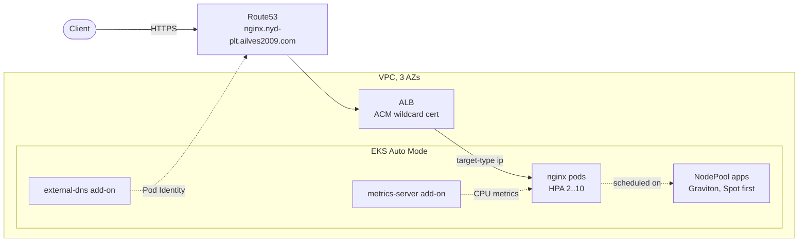

> Series "Golden pipeline" - Each POC represents my vision of a modern enterprise platform, exploring a different platform engineering decision: what to standardise, what to automate, what to delegate to managed services, and where teams should retain control.

# Innovate Inc. — POC: Amazon EKS Auto Mode with Terragrunt

A public NGINX service with HTTPS, pod autoscaling and node autoscaling on
**Amazon EKS Auto Mode**, built with Terraform and Terragrunt in a clean AWS account.

The point of this POC is to show **how much of the platform AWS can run for you**.
A companion project,
[poc-aws-eks-karpenter](https://github.com/ailves2009/poc-aws-eks-karpenter),
builds the same kind of platform the self-managed way: Karpenter, the AWS Load
Balancer Controller and IRSA installed and operated by hand.

| Concern                           | Self-managed (karpenter POC)                      | **EKS Auto Mode (this POC)**                                  |
| --------------------------------- | ------------------------------------------------- | ------------------------------------------------------------- |
| Node provisioning                 | Karpenter Helm chart, IAM, SQS interruption queue | Built in; AWS runs Karpenter in the control plane             |
| Node OS / patching                | Your AMI choice, your upgrade cadence             | Bottlerocket-based, immutable, replaced at most every 21 days |
| Load balancers                    | AWS Load Balancer Controller (Helm + IRSA)        | Built in (`eks.amazonaws.com/alb` IngressClass)               |
| CNI, kube-proxy, CoreDNS, EBS CSI | EKS add-ons you version and upgrade               | Built in and upgraded by AWS                                  |
| Workload IAM                      | IRSA (OIDC provider)                              | EKS Pod Identity only (no OIDC provider)                      |
| Customisation                     | Full control of controllers and node AMIs         | `NodePool` / `NodeClass` / `IngressClassParams` CRDs          |
| Cost                              | EC2 only                                          | EC2 plus a per-instance Auto Mode management fee              |

## What gets deployed



| Stack (`envs/main/plt/poc/…`) | Module             | What it does                                                                                                    |
| ----------------------------- | ------------------ | --------------------------------------------------------------------------------------------------------------- |
| `dns`                         | `modules/dns`      | Public hosted zone for `nyd-plt.ailves2009.com` (or looks up an existing one)                                   |
| `vpc`                         | `modules/vpc`      | VPC across 3 AZs: private /20 subnets for nodes and pods, public subnets for ALBs, NAT, Flow Logs               |
| `acm`                         | `modules/acm`      | Wildcard ACM certificate, DNS validation, expiry alarms and dashboard                                           |
| `eks`                         | `modules/eks`      | EKS Auto Mode cluster, access entries, `metrics-server` and `external-dns` community add-ons, Pod Identity role |
| `platform`                    | `modules/platform` | Custom `NodePool` (arm64, Spot then On-Demand), `IngressClassParams` and the `alb` IngressClass                 |
| `nginx`                       | `modules/nginx`    | Hardened NGINX Deployment, Service, PDB, HPA v2 and Ingress                                                     |

Bootstrap (`envs/pred/plt/poc/…`): `iam-state` (scoped CI/CD role) and
`s3-state` (versioned, KMS-encrypted state bucket with TLS-only policy).

## How the requirements are met

**Managed EKS cluster.** Kubernetes 1.37 on EKS Auto Mode with `authentication_mode = "API"`
(access entries, no `aws-auth` ConfigMap) and control plane logs in CloudWatch.
There are no managed node groups, no SSH keys and no self-installed controllers.

**Node autoscaling.** Auto Mode runs Karpenter for you. The built-in `system` and
`general-purpose` NodePools run cluster components. The custom `apps` NodePool
([modules/platform/main.tf](modules/platform/main.tf)) shows how workloads are
steered with plain Karpenter v1 objects:

- Graviton only (`kubernetes.io/arch = arm64`);
- Spot preferred, On-Demand as fallback;
- `c`/`m` families, generation 6 or newer;
- `WhenEmptyOrUnderutilized` consolidation after 1 minute;
- a CPU/memory ceiling as a cost guard.

**Pod autoscaling.** HPA v2 on CPU, 2–10 replicas, with explicit scale-up and
scale-down `behavior`. Metrics come from the `metrics-server` **EKS community
add-on**, so there is no Helm release to maintain.

**Public access.** An Ingress with `ingressClassName: alb` makes Auto Mode create an
internet-facing ALB. The scheme and ACM certificate live in `IngressClassParams`.
HTTP is redirected to HTTPS. The `external-dns` community add-on, authenticated
through **EKS Pod Identity**, creates the Route53 record, so Terraform never
has to wait for the ALB hostname.

**Workload hardening.**

- Namespace enforces Pod Security `restricted`.
- Unprivileged NGINX image (UID 101, port 8080).
- Read-only root filesystem, all capabilities dropped, `RuntimeDefault` seccomp.
- Zone topology spread and a PodDisruptionBudget.

## IaC layout and practices

```
envs/
├── pred/plt/poc/            # bootstrap, local state
│   ├── root.hcl
│   ├── iam-state/
│   └── s3-state/
└── main/plt/poc/            # workload, S3 state
    ├── root.hcl             # remote_state, providers, shared inputs (domain is set only here)
    ├── k8s.hcl              # kubernetes provider via `aws eks get-token`
    ├── dns/  vpc/  acm/  eks/  platform/  nginx/
modules/
└── dns/  vpc/  acm/  eks/  platform/  nginx/  iam-state/  s3-state/
```

- **DRY Terragrunt.**
  - One `remote_state` block in `root.hcl` derives the state key from the stack path.
  - The S3 backend uses native lockfiles.
  - Provider and version files are generated once.
- **No credentials in state.** The Kubernetes provider authenticates with
  short-lived `aws eks get-token` exec credentials. Tokens are not passed between stacks.
- **Kubernetes objects split out.** Objects that need a live API server
  (`kubernetes_manifest` with Auto Mode CRDs) sit in their own stacks after `eks`.
- **Pinned versions.** Module and provider versions are pinned, and
  `allowed_account_ids` guards against applying to the wrong account.
- **Least-privilege CI/CD role.**
  - IAM changes are limited to `<cluster_name>-*` roles and policies.
  - EKS actions are limited to the one cluster.
  - Destructive KMS actions are limited to keys tagged with this project.
  - EC2 access is pinned to the deployment region.

## Deploy

Prerequisites: Terraform ≥ 1.10, Terragrunt ≥ 0.80, AWS CLI v2 and kubectl,
with credentials for your AWS account.

> The account ID lives only in [`envs/account.hcl`](envs/account.hcl), which is
> committed with the AWS documentation placeholder `111122223333`. Put your own ID
> there and keep it out of git:
>
> ```bash
> git update-index --skip-worktree envs/account.hcl
> ```
>
> `allowed_account_ids` in the generated provider stops any apply against a different account.

```bash
# 1. Bootstrap (local state; keep the generated terraform.tfstate safe)
cd envs/pred/plt/poc
terragrunt run --all apply

# 2. Hosted zone, then delegate it from the parent zone (ailves2009.com)
cd ../../../main/plt/poc/dns
terragrunt apply
terragrunt output name_servers   # create an NS record for nyd-plt in ailves2009.com

# 3. Everything else, in dependency order
cd ..
terragrunt run --all apply
```

### DNS delegation (required before step 3)

The `dns` stack creates a separate public zone for `nyd-plt.ailves2009.com`
(the domain is set once in `envs/main/plt/poc/root.hcl`). The parent zone
`ailves2009.com` is **not** hosted in the POC account. It lives at the
domain registrar or in another AWS account, so Terraform cannot delegate to it.
Until the parent zone has an NS record for `nyd-plt`, the internet cannot
resolve the new zone, so the ACM DNS validation in the `acm` stack never
completes (`aws_acm_certificate_validation` waits until it times out).

1. Get the four name servers of the new zone:

   ```bash
   cd envs/main/plt/poc/dns
   terragrunt output -json name_servers
   ```

2. In the DNS provider of `ailves2009.com`, create an `NS` record:
   name `nyd-plt`, values = those four name servers, TTL 300.
   If the parent zone is in Route53 in another account:

   ```bash
   aws route53 change-resource-record-sets --hosted-zone-id <PARENT_ZONE_ID> \
     --change-batch '{"Changes":[{"Action":"UPSERT","ResourceRecordSet":{
       "Name":"nyd-plt.ailves2009.com","Type":"NS","TTL":300,
       "ResourceRecords":[{"Value":"ns-1.awsdns-00.org"},{"Value":"..."}]}}]}'
   ```

3. Check the delegation before continuing:

   ```bash
   dig +short NS nyd-plt.ailves2009.com   # must return the same four name servers
   ```

`run --all plan` on an empty account works for the AWS stacks through mock outputs.
`platform` and `nginx` can only be planned after `eks` exists, because they
talk to the Kubernetes API.

## Verify

```bash
aws eks update-kubeconfig --region eu-west-3 --name nyd-plt-eks

kubectl get nodepools                       # system, general-purpose, apps
kubectl get nodes -L karpenter.sh/nodepool,karpenter.sh/capacity-type,kubernetes.io/arch
kubectl -n nginx get deploy,hpa,pdb,ingress
curl -I https://nginx.nyd-plt.ailves2009.com  # HTTP/2 200, HTTP -> HTTPS redirect
```

Watch both autoscaling layers react to load:

```bash
kubectl -n nginx run load --image=busybox:1.37 --restart=Never -- \
  /bin/sh -c 'while true; do wget -q -O- http://nginx-demo; done'

kubectl -n nginx get hpa nginx-demo -w      # replicas grow as CPU passes 70%
kubectl get nodeclaims -w                   # Auto Mode adds arm64 Spot nodes when pods go Pending

kubectl -n nginx delete pod load            # scale-down after ~5 min; nodes consolidate
```

## Destroy

```bash
cd envs/main/plt/poc
terragrunt run --all destroy   # nginx first, so the ALB and DNS records are removed before the cluster
```

The state bucket has `prevent_destroy`. Remove it only on purpose.

## Trade-offs and next steps

- **Cost.**
  - A single NAT gateway and a public API endpoint (`0.0.0.0/0`) keep the POC cheap and easy to reach.
  - In production: one NAT per AZ (or IPv6 / VPC endpoints), and a private endpoint or restricted CIDRs.
- **CI/CD.** The `cicd-role` trusts an IAM user. GitHub Actions or GitLab OIDC
  federation would remove long-lived keys.
- **Delivery.** GitOps (Argo CD) for the `nginx` workload instead of Terraform.
- **Observability.** CloudWatch Container Insights or Amazon Managed
  Prometheus/Grafana. Auto Mode node logs are available through the `NodeDiagnostic` CRD.
- **Network policies.** Auto Mode supports Kubernetes `NetworkPolicy` through the
  built-in VPC CNI. Enable it with a custom `NodeClass` and add default-deny policies.

---

License: MIT (see [LICENSE](LICENSE)). Authors: see [CONTRIBUTORS.md](CONTRIBUTORS.md).
